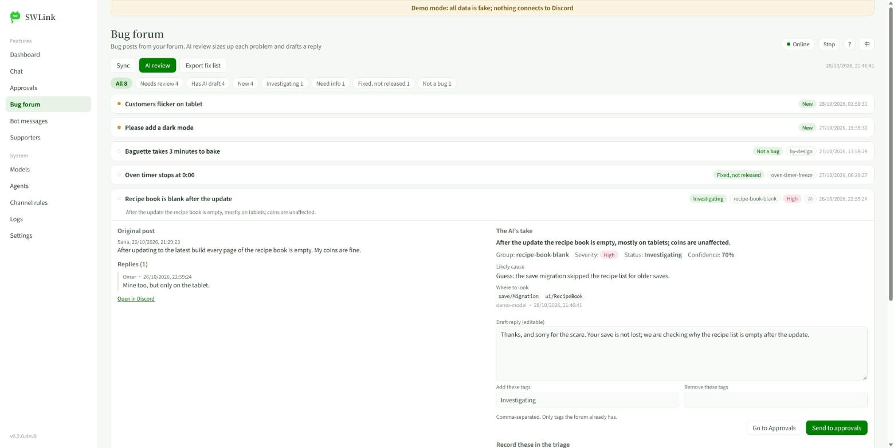
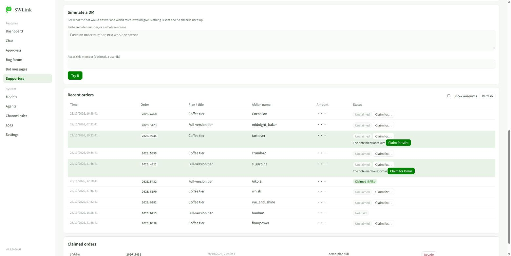

# SWLink

**给小型游戏社区用的本地控制台 + Discord 机器人。AI 起草，你来拍板。**

SWLink 跑在你自己的电脑上，在浏览器里打开。一个机器人，管五件事：

- **Bug 论坛**：同步帖子，让 AI 先看一遍（什么问题、该去哪查、回复草稿），你在一个地方批准回复和标签。修好发版后，每个报告人都会收到回音。
- **聊天**：每个频道和私信单独选：不理、只起草（你批准）、自动回复（有每小时上限）。
- **支持者**：在爱发电付过款的人私信订单号，自动拿到支持者身份组。金额不公开。
- **机器人消息**：机器人发过的消息，随时改字或删除。
- **AI 编程助手**：Claude Code、Codex 等 MCP 客户端可以分诊、起草，但不能直接发。



不接 Discord 也能先试：演示模式用假服务器、假订单、假模型，什么都不会连出去。

```
pip install -e ".[all]"
swlink --demo --lang zh
```

[English](README.md) · [用户手册](docs/swlink-manual.zh-CN.md) · [设计文档](docs/DESIGN.md) · [同类项目对比](docs/LANDSCAPE.md) · [Agent 使用手册](integrations/AGENT_PLAYBOOK.md)

## Hearback：底下的 bug 工作台

**每个报 bug 的玩家，都能收到回音。** SWLink 建在 Hearback 上：给 **Discord 论坛频道**用的「AI 分诊 + 人工把关」
bug 工作台。多个 AI 编程助手通过共享台账和 MCP 服务一起分诊；所有公开发言都要人批准；修复发布后，每个报告人
都会在自己的帖子里收到「哪个版本修好了、怎么更新」的回复。下面这些不开控制台、只用命令行也能用。

## 解决什么问题

小团队（独立游戏、同人 / 复刻游戏、开源工具）常用 Discord 论坛收 bug。收集不难，难的是之后的闭环：

- 同一个根因被六个人用六种说法报了六遍；
- AI 每次都把整个论坛重读一遍，又慢又费 token，还会把处理过的帖子重新分诊；
- 回复是公开的，AI 不能自己乱发；但一条条人工批准又太累；
- 修好发包以后，没人回头告诉那 22 个报告人 —— 玩家觉得石沉大海，就不再报 bug 了。

这个项目是从一个真实游戏社区的 bug 专区流程里抽出来的：29 个帖子、22 个修复，发包当天所有相关报告人都收到了通知。

## 和现有工具的区别

| | 一般的 Discord 机器人 / MCP 服务 | Hearback |
|---|---|---|
| AI 的记忆 | 每次重读论坛 | **台账**：没变化的帖子不用逐帖重新拉取，AI 也不花 token；AI 只看几行增量 |
| 安全 | AI 工具可以直接发帖 | **AI 的工具里没有发送**，只能提议；人批准（命令行、桌面窗口、或私密频道里点 ✅）；发送幂等、发完回读核对。能直接跑命令的 AI（Claude Code、Codex）要靠「不给它机器人令牌」来隔离，见英文 README 的 Safety model |
| 修好以后 | 关 issue，报告人被遗忘 | **发版闭环**：`hearback release 1.2.0` 给每个相关报告人起草一条、按他用的版本写的回复 |
| 多个 AI | 互相打架 | **认领租约 + 分诊版本号 + 审计日志**：Claude 分诊的同时 Codex 修 bug |
| 报告质量 | 玩家写什么是什么 | **报告人引导包**：自动生成置顶「怎么报 bug」帖，带标注截图 |
| 人的温度 | 机器人发了就定了 | **桌面工作台**：事后改 / 删机器人的消息 |

## 30 秒体验（不需要 Discord）

```bash
git clone https://github.com/Cynthia-wlan9509/hearback
cd hearback
python -m pip install -e .
hearback demo --lang zh
```

演示用内存里的假 Discord，装了一个虚构游戏《Starlight Bakery》的 12 个 bug 帖，把整个流程跑一遍：
同步 → 两个 AI 分诊（一个撞上别人的认领、一个版本号过期被拒）→ 14 条提议 → 私密频道点反应批准（非管理员的 ✅ 被忽略）
→ 发送 → 核对 → 增量同步 → 体验版发版通知、完整版发版通知 → 总表。大约 1 秒跑完。

## 在自己的服务器上用

需要 Python 3.11+。核心**零依赖**；MCP 服务需要装 `mcp` 扩展。

1. 在 <https://discord.com/developers/applications> 建 bot：Bot → Reset Token；打开 **Message Content Intent**；
   OAuth2 → URL Generator 勾 `bot` 和 View Channels、Read Message History、Send Messages、Send Messages in Threads、
   Create Public Threads、Manage Threads、Attach Files、Add Reactions，用生成的链接把 bot 拉进服务器。
2. `hearback init` 生成带注释的 `hearback.toml`，填 `forum_id`、你发的版本（比如体验版 / 完整版）和状态对应的论坛标签名。
3. 令牌放环境变量 `DISCORD_BOT_TOKEN` 或 `.hearback/token.txt`（已在 .gitignore 里）。Hearback 从不打印它。
4. 日常流程见 [README.md](README.md#use-it-on-your-server) 的命令示例；`hearback editor` 打开桌面工作台。

## 接入 AI

`pip install -e ".[mcp]"` 后，让 MCP 客户端运行 `hearback mcp`。每个 AI 用自己的名字（`HEARBACK_ACTOR`），
审计日志和认领才分得清是谁。Claude Code、Codex、OpenAI Agents SDK 的配置示例见 [README.md](README.md#plug-in-your-agents)
和 `integrations/`。MCP 工具里**故意没有**发送、批准、编辑、删除；论坛内容一律包在「不可信数据」的标记里返回，
降低有人在帖子里写指令操纵 AI 的风险（降低不等于杜绝，所以 AI 写的任何东西都要人批准才会公开）。
机器人发出的每条消息都关掉了 @ 提醒，帖子标题里塞的 @everyone 也会被处理掉。

## SWLink：网页控制台 + 聊天机器人



SWLink 是 Hearback 里**可选、需要自己开启**的部分：一个本地网页，加一个常驻的聊天机器人。你在网页里决定机器人在哪些服务器、
频道、私信里回答，用哪个**智能体**（系统提示词），用哪个**大模型**（你自己的 API 密钥：Anthropic、OpenAI、DeepSeek，
或任何兼容 OpenAI / Anthropic 接口的中转站），以及模式是**关闭**、**起草后等你批准**还是**自动回复**。
同一个页面还能看审批队列和 Bug 论坛台账。完整的操作说明见 [SWLink 使用手册](docs/swlink-manual.zh-CN.md)。

```
pip install -e ".[all]"        # 或只装需要的：llm、bot、keyring、mcp
hearback web                   # 也可以用 swlink。浏览器会打开 http://127.0.0.1:8765/
```

第一次用：**设置**（粘贴机器人令牌，照开发者门户的步骤做，用邀请链接）→ **模型**（添加配置和密钥，点测试）→
**频道规则**（选频道、选模式）→ **仪表盘** → 启动。`hearback web --no-browser --port 0` 只打印链接、自动选空闲端口。

想先看看效果？运行 `hearback web --demo`（要中文数据就加 `--lang zh`），会打开同一个控制台，里面全是编出来的数据：假的服务器、论坛、待审批和支持者。不需要 Discord、不需要密钥、不联网，什么都不保存，停止后临时文件夹自动删除。适合先试用各个页面，也适合截图和录屏。

安全模型：

- 一切默认**关闭**。自动回复按频道（或私信默认）单独开启，开启时要确认，并有每小时上限（`[swlink] hourly_cap`，默认 60，每次调用模型都算），
  超过后只记录、不回复。
- **草稿**模式把模型的回复放进原有的审批队列，署名 `agent:swlink`；由人在控制台批准（`human:web`）再发送。
  原有规则不变：agent 不能批准也不能发送。
- 机器人只在被邀请进去的服务器里工作，走官方机器人接口。用普通用户账号当机器人（selfbot）违反 Discord 规则，不支持。
- API 密钥放系统钥匙串（服务名 `hearback-swlink`），或环境变量 `HEARBACK_LLM_KEY_<配置 ID>`。密钥不会写进
  `.hearback/llm.json`、日志、事件或任何网页响应；机器人令牌在控制台里同样只写不读。
- 页面只监听 `127.0.0.1`，链接里带本次运行的密钥，检查 Host，使用严格的内容安全策略，不请求任何外部资源。
  Discord 文字作为「不可信数据」包好再交给模型，所有发出的消息都关掉 @ 提醒。
- 机器人看到的近期消息保存在 `.hearback/inbox.jsonl`（已被 gitignore，保留最后 5000 行）。

**Bug 论坛 AI 审核。** 在**设置**里填服务器 ID 和论坛频道 ID（会存进 `hearback.toml`），点**同步**，再点 **AI 审核**。
对每个还没人处理（或有新回复）的帖子，模型会把建议写进 `triage.ai`：一句话概括、归类、严重程度、建议状态、可能原因、
该去哪查、还要向玩家要什么，以及一份回复草稿。它不会改动人工填写的字段。在帖子展开面板里可以改草稿，点**放进待审批**
（回复和标签仍然走审批队列），或点**采纳分诊**把选中的字段记进真正的分诊。**导出修复清单**会生成按归类分组的 markdown
任务单，交给写代码的 agent。**机器人消息**页列出机器人在某个帖子或频道里发过的消息，可以改字或删除。截图（最多 3 张）
和 `.txt`/`.log` 附件里的报错行会一起发给模型；同步时会下载这些附件。

**爱发电支持者身份组。** Discord 自带的付费身份组只在美国可用，很多国内创作者改用爱发电收赞助。**支持者**页把两边接起来：
支持者在爱发电付款后，把订单号私信给机器人，机器人用爱发电的开放接口核对，通过就给支持者身份组。把爱发电的 `user_id` 和
API Token 填进去（Token 只放系统钥匙串或环境变量 `HEARBACK_AFDIAN_TOKEN`，不写进任何文件），选好身份组，先用**模拟私信**试一下，
再打开**私信核对**。回复是固定模板（不经过模型）；金额不会出现在任何回复和通知里；通知和日志里的订单号只显示头尾各 4 位；
一个订单只能被认领一次，群主可以手动认领或撤销。机器人的身份组排在支持者身份组下面时，页面会明确告诉你把哪个拖到哪个上面。

## 路线图

- 看图分诊 agent：理解截图和日志、把重复报告归类（Agents SDK）
- 用报告人的语言回复（英文 / 马来文 / 中文社区）
- Codex 当修复 agent：认领一个 bug 簇、在游戏仓库里修、把修复说明和版本号写回台账 → 发版通知
- 导出到 GitHub Issues / Linear

## 引用与署名

如果 SWLink / Hearback 帮到了你的项目、论文或分享，请引用它。仓库页右侧的 **Cite this repository**
（来自 [CITATION.cff](CITATION.cff)）可以直接复制 APA 和 BibTeX，也可以用下面这段：

```bibtex
@software{swlink_hearback,
  author  = {Cynthia-wlan9509},
  title   = {SWLink (Hearback): a human-approved bug desk and Discord bot for game communities},
  year    = {2026},
  version = {0.2.0},
  url     = {https://github.com/Cynthia-wlan9509/hearback}
}
```

欢迎在它上面改、做延伸。MIT 许可要求保留版权声明；也请在你的 README 里写一句
「基于 Cynthia-wlan9509 的 [SWLink / Hearback](https://github.com/Cynthia-wlan9509/hearback)」，方便别人找到原项目。

## 许可

MIT © 2026 Cynthia-wlan9509 and contributors
